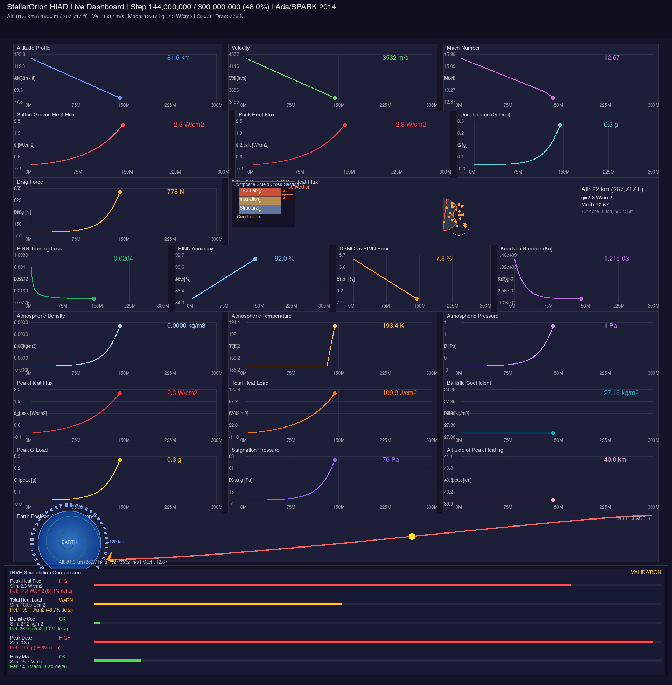
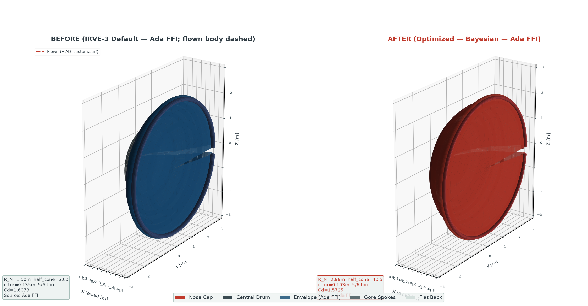
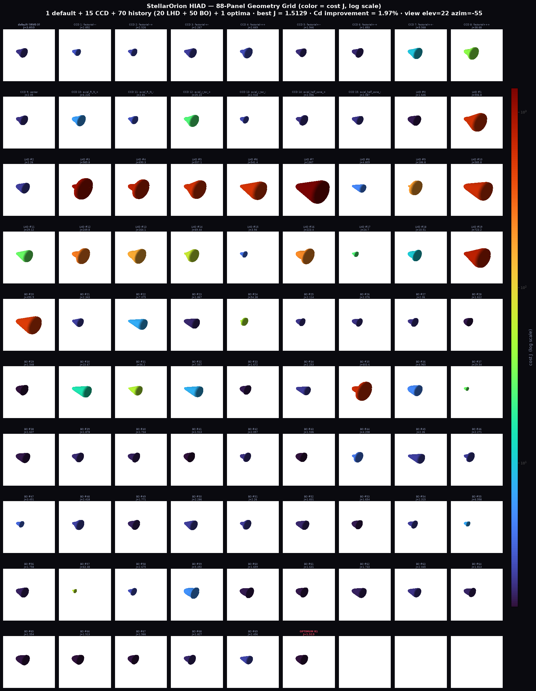

# StellarOrion HypersonicEdition

**Author:** Albert Starfield Wahyu Suryo Samudro

**Supervised by:**
1. Dr.-Ing. Mochammad Agoes Moelyadi, ST., MSc.
2. Yohanes Bimo Dwianto, S.T., M.T., Ph.D.

---

StellarOrion is a high-fidelity aerothermodynamic simulation and optimization suite for Hypersonic Inflatable Aerodynamic Decelerators (HIAD). It leverages the **SPARTA DSMC** solver for rarefied gas dynamics (Plimpton & Gallis, 2014) and a **Bayesian Optimization (GP Matern 5/2 + Expected Improvement)** stage for survivability optimization.

> **Note:** The legacy `main.py` entry point was deprecated on 2026-08-21 and has since been
> removed from the repository. All functionality now lives in the Ada/SPARK binary and the
> Python sidecar — use `python3 stellarorion_program_proc/run.py` instead.

## 🚀 Quick Start

```bash
cd stellarorion_program_proc
python3 run.py --self-test        # Run 18 verification tests
python3 run.py --test sample      # Run single SPARTA sample with 11-metric comparison
python3 run.py --help             # Show all CLI flags
```

## 🏗️ Architecture

This project uses a hybrid architecture for running simulations:

- **Ada/SPARK Binary:** Primary simulation engine (`stellarorion_program_proc/`). Compiled with Alire, formally verified with GNATprove `--level=4` (493 checks, 390 proved, 103 unproved — all 103 in the untouched `stellarorion_postprocessing` analytics unit, **0 new obligations unproved** by the F-TPS work; run 2026-10-04). Handles all 19 CLI modes including validation, optimization, calibration, and integration tests.
- **Docker:** Used exclusively for running the SPARTA DSMC simulation in a containerized Linux environment.
- **Python Sidecar:** Native OS Python environment for PINN refinement (DeepXDE), PyFluent/PyAnsys integration, and GUI launcher. Supports NVIDIA CUDA, AMD ROCm, Apple Metal (MPS), Intel OneAPI/OpenCL, and specialized accelerators.
  > ⚠️ **The DeepXDE PINN leg does not currently run.** `PINNAccelerator.train_from_checkpoint` raises `AttributeError` before its first iteration, the DSMC targets it parses are discarded so the PINN is supervised to output zero, its grid parser mis-places 22.80 % of cells across the axis of symmetry, and `compute_pinn_metrics` raises `IndexError`. The Ada layer nevertheless records `pinn_calibration` as `Status_Completed, 1.0`. Verified by execution against `venv_validation` (deepxde 1.15.0). Treat every PINN-derived figure as void until this is fixed — see footnote ⁸ and `FAILURES_AND_FIXES.md` **F24–F33**.

---

## 📁 Source Layout (`stellarorion_program_proc/`)

Inventory as of 2026-09-23 (51 Ada units · ~35.4k Ada LOC · ~35.2k Python LOC under `src/`).

```text
stellarorion_program_proc/
├── run.py                 # Primary CLI entry (1,492 lines) — replaces deprecated main.py
├── alire.toml             # Alire crate (declares executable stellarorion_project; built binary: bin/main)
├── stellarorion_program_proc.gpr   # Main GPR → src/simulation_engine, Main: main.adb
├── stellarorion_pinn_lib.gpr        # PINN shared-library project
├── prove.sh / run_smooth.sh         # Legacy proof+coverage runner and smooth-geometry runner (proof gate = scripts/prove.sh)
├── compare_validation.py            # Standalone validation comparison
├── postprocess_validation.py        # Post-process DSMC/validation outputs
├── scripts/
│   ├── validate_tps_conduction_limits.py   # 5 physics limits + ABI exposure for the F-TPS solver
│   ├── run_tps_conduction_step2200.py      # Per-element F-TPS solve over the step-2200 SPARTA snapshot
│   └── prove.sh                           # gnatprove --level=4 wrapper
│
├── src/
│   ├── simulation_engine/           # Ada/SPARK primary engine (25 packages + main.adb)
│   │   ├── main.adb                 # GPR main → dispatches into StellarOrion_Project
│   │   ├── stellarorion_project.*   # Entry + CLI surface (~1,900 lines: .adb+.ads)
│   │   ├── stellarorion_cli.*       # Has_Flag / Get_Option / Get_Float (SPARK On)
│   │   ├── stellarorion_self_test.* # 18 verification tests
│   │   ├── stellarorion_test_modes.*# --test sample|baseline|pinn|sparta|…
│   │   ├── stellarorion_sparta.*    # SPARTA DSMC driver (~4.5k lines body)
│   │   ├── stellarorion_physics.*   # Aerothermodynamics, Sutton-Graves, …
│   │   ├── stellarorion_geometry.*  # HIAD geometry / IRVE-3 baseline
│   │   ├── stellarorion_environment.* # ISA atmosphere, Mach/alt tables
│   │   ├── stellarorion_pinn_trajectory.* # Linear entry trajectory
│   │   ├── stellarorion_trajectory_output.* # T1: H(0)=120 km, H(300M)=40 km
│   │   ├── stellarorion_ffi.*       # C ABI for Python ctypes sidecar
│   │   ├── stellarorion_optimization.* / stellarorion_optimize.*  # BO/GA hooks
│   │   └── validation, postprocessing, reports, status_writer, types,
│   │       history, pipeline_checkpoint, dual_watchdog, runtime_guard, …
│   │
│   ├── python/                      # Python sidecar (20 modules)
│   │   ├── validation_pipeline.py   # Unified comparison + convergence audit
│   │   ├── ada_pinn_wrapper.py      # ctypes FFI → libstellarorion_pinn
│   │   ├── hiad_optimizer.py        # Bayesian optimization driver
│   │   ├── generate_outputs.py      # Dashboard MP4 / overlay panels
│   │   └── kriging_denoise, pinn_*, pipeline_*, sidecar_*, …
│   │
│   ├── ui/                          # sidecar_ui.py + frontend/ + uiassets/ (TS)
│   ├── sidecar_ui/                  # Standalone sidecar HTML/JS shell
│   ├── utils/                       # sabotage_verifier.py, add_exception_handlers.py
│   ├── proofs/  rocq/               # Coq proof skeletons per unit
│   └── …
│
├── scripts/                         # Plot/report generators + prove.sh + SabotageVerifier.sh
├── tests/                           # test_main.adb (Ada harness) + test_run_pipeline.py
├── tools/                           # plot_surf_profile.py
├── config/                          # Generated config .ads/.gpr/.h
├── docs/                            # AXIOMS, APPLICATIONS, CITATIONS, PROJECT_DECOMPOSITION_PLAN, …
├── data/  results/                  # Run status JSON, validation plots/VTU/CSV
├── alire/  bin/  obj/  lib/         # Alire deps + build artifacts
└── proofs/                          # Coq/Rocq proof skeletons (GNATprove artifacts: obj/gnatprove/)
```

**Entry path:** `python3 run.py` → compiled binary `bin/main` (`run.py` `_find_binary()`; GPR `Main: main.adb` in `src/simulation_engine/`). Note: `alire.toml` declares the crate executable as `stellarorion_project`, but the built/launched binary is `bin/main`.

---

## 🎬 Live Dashboard Animation

Real-time aerothermodynamic visualization of the IRVE-3 HIAD reentry — featuring Sutton-Graves heat flux, PINN training metrics, composite material cross-section with heat propagation, and animated Earth trajectory.



**Full animation:** [hybrid_dsmc_pinn_animation.mp4](stellarorion_program_proc/results/validation_scalloped/plots/hybrid_dsmc_pinn_animation.mp4) (111s, 30fps, 87 MB)

The video has four segments: a 2s title card, the main live dashboard (~100s, curves grow frame-by-frame), then three 3s focus segments — **Trajectory** (altitude / velocity / Mach), **Thermal** (Sutton-Graves heat flux / Mach), and **Mechanical** (drag / G-load / Mach). Pass `--validation` when regenerating to overlay the 5-metric IRVE-3 comparison panel (Peak Heat Flux, Total Heat Load, Ballistic Coeff, Peak Decel, Entry Mach), or `--optimized-topology` to overlay the Bayesian-optimization before/after comparison panel (nose radius, torus radius, half-cone angle, C<sub>d</sub> reduction).

**Dashboard panels:**
- Row 1: Altitude / Velocity / Mach Number
- Row 2: Sutton-Graves Heat Flux / Peak Heat Flux / Deceleration (G-load)
- Row 3: Drag Force / IRVE-3 Vehicle (with composite material inset & heat propagation)
- Row 4: PINN Training Loss / PINN Accuracy / DSMC vs PINN Error / Knudsen Number
- Row 5: Atmospheric Density / Temperature / Pressure
- Row 6: Peak Heat Flux / Total Heat Load / Ballistic Coefficient
- Row 7: Peak G-Load / Stagnation Pressure / Altitude of Peak Heating
- Row 8: Earth Position & Flight Trajectory (animated spiral Earth, orange arrowhead)

```bash
# Regenerate animation
cd stellarorion_program_proc/src/python
python3 generate_outputs.py --mp4-only

# Cap dashboard frames for fast iteration (e.g. 300 frames ≈ 10s of dashboard)
python3 generate_outputs.py --mp4-only --max-frames 300

# Include the IRVE-3 validation overlay panel (dedicated bottom strip)
#   → stellarorion_program_proc/results/validation_scalloped/plots/hybrid_dsmc_pinn_animation_validation.mp4
python3 generate_outputs.py --mp4-only --validation

# Include the optimized-topology before/after overlay panel (dedicated bottom strip)
#   → stellarorion_program_proc/results/OptimizedTopology/plots/hybrid_dsmc_pinn_animation_optimized.mp4
python3 generate_outputs.py --mp4-only --optimized-topology
```

---

## 🛠️ Requirements & Installation

- **Docker:** Required for SPARTA simulation.
- **Python 3.10+**: Recommended (for build pipeline and PINN sidecar).
- **Ada/Alire:** Required for the primary simulation binary.
- **Dependencies:** Auto-installed by `run.py` (hash-gated venv).

```bash
cd stellarorion_program_proc
python3 run.py --help          # Show all CLI flags
python3 run.py --self-test     # Run 18 verification tests
```

---

## 🧮 Theory & Derivation

For all mathematical models (DSMC rarefied gas dynamics, aerothermodynamics, Sutton-Graves, radiative equilibrium, 1D thermal model, optimization cost functions, PINN Navier-Stokes), see **[DERIVATION.md](DERIVATION.md)**.

---

## 🧱 Composite F-TPS Conduction Solver (IRVE-3 Layup)

The vehicle's thermal protection is a **5-ply flexible TPS (F-TPS)**, not a monolithic
slab. The solver models it as an ordered composite stack and returns the full in-depth
temperature field, not just two boundary numbers.

### Layup — `TPS_Layup_IRVE3` (`stellarorion_types.ads`)

| # | Ply | Material | Thickness | k [W/(m·K)] |
|---|-----|----------|-----------|-------------|
| 1 | outer fabric | Nextel BF-20 | 0.60 mm | 0.25 |
| 2 | outer fabric | Nextel BF-20 | 0.60 mm | 0.25 |
| 3 | insulation | Pyrogel 2250 | 2.50 mm | 0.02 |
| 4 | insulation | Pyrogel 2250 | 2.50 mm | 0.02 |
| 5 | gas barrier | AKK (aluminized Kapton / Kevlar) | 0.15 mm | 0.12 |

* Total **6.35 mm = 0.25 in**, outer emissivity **0.80**, structure limit **523.15 K (250 °C)**.
* Series resistance **R = 0.25605 m²·K/W**; the `k` values are *effective through-thickness*
  ply conductivities (a felt ply conducts far less than its solid constituent because the
  conduction path crosses inter-fibre voids).
* **This replaced a wrong-vehicle default.** The previous active TPS was the homogeneous
  25.4 mm `TPS_SiC` slab — the *LOFTID* baseline, 4× too thick for IRVE-3. `--tps` now
  defaults to `irve3-ftps`, and its lumped-equivalent properties are **derived from
  `TPS_Layup_IRVE3` itself** (`TPS_IRVE3_FTPS`, verified at run time by self-test Test 10),
  so the published ply schedule stays the single source of truth. `--tps sic` still works.

### Model

Steady 1-D composite conduction with a radiation boundary condition on the hot face and a
**pinned** cold face, `T(L) = T_init`:

```
q = (T_s − T_init)/R  +  ε·σ·(T_s⁴ − T_inf⁴)
```

`T_s` is found by bisection in `Long_Float` (binary32 `Float` cannot resolve the 1e-9
relative bracket tolerance — see the note in `stellarorion_physics.adb`). The profile is
piecewise linear in **thermal resistance**, which is why it is exactly linear in depth for
a single homogeneous ply.

### Interfaces

| Layer | Entry point | Role |
|-------|-------------|------|
| Ada | `StellarOrion_Physics.TPS_Conduction` / `TPS_Conduction_Profile` | solver + profile |
| Ada | `StellarOrion_Physics.SG_Scaled_Element_Flux` | `q_i = Q_SG·clamp(Ke_Raw/Ke_Ref, 0, 1)` |
| C ABI | `TPS_Conduction_C` (`stellarorion_ffi.ads`) | exports `q_SG`, `T_s`, `T_back`, 33-point profile |
| Python | `ada_pinn_wrapper.tps_conduction()` | thin ctypes wrapper — **no physics in Python** |

### Running it

```bash
cd stellarorion_program_proc

# 1. The five physics limits (thin-insulator, thick-layer, single-layer
#    closed form, isothermal, layer-permutation invariance) + ABI exposure.
python3 scripts/validate_tps_conduction_limits.py

# 2. Per-element solve over the step-2200 SPARTA snapshot.
python3 scripts/run_tps_conduction_step2200.py
```

Both exit non-zero on any failure. Measured results (A4, 189 pp, see below):

* **Limits:** 34 checks, 0 failures. The steady surface balance closes to
  **1.4 × 10⁻⁷** relative on the IRVE-3 layup — inside the binary32-derived bound — and
  `T_s`, `T_back` and `R_total` are invariant across **all 120** ply orderings.
* **Per-element:** 3648 elements solved in ~0.25 s. Peak Sutton-Graves flux
  **266 509 W/m² (26.65 W/cm²)** at h = 51.8 km, V = 3378 m/s, R_n = 0.55 m —
  **within the Nextel BF-20 30 W/cm² rating**. ⁶ 624 elements receive `q_i = 0`
  (192 have genuinely negative raw DSMC flux; 432 read exactly zero), which the
  `clamp(·, 0, 1)` floors rather than passing through as negative heating.

Outputs land in `stellarorion_program_proc/results/tps_conduction/`:
per-element CSV, the 33-sample profile CSV (120 384 rows), and a summary JSON.

> ### ⚠️ Known consequence: the `--validate` gate now reports survivability FAIL
>
> Switching the active TPS from the 25.4 mm SiC baseline to the real 6.35 mm IRVE-3
> F-TPS **changed a downstream number**, and the full SPARTA pipeline now reports:
>
> ```
> [VALIDATE] Step 8: Survivability check ...
>   Survivability: FAILED -- vehicle does not survive.
>   Backface temp :  9.55662E+02 K      (KAPTON_MAX_TEMP = 673 K)
> [VALIDATE] RESULT: VALIDATION FAILED
> ```
>
> **Cause — measured, not inferred.** `Is_Survivable` is
> `Surface_Temp ≤ 1700 ∧ Backface_Temp ≤ 673 ∧ G_Load ≤ 25 ∧ Decel_G ≤ 25`. Of those
> four terms only the back-face one fails (1296.65 ✓, **955.66 ✗**, 17.73 ✓, 17.73 ✓).
> The back-face number comes from the legacy single-slab transient estimate
> `T_init + q·Δt·η_lag /(ρ·c_p·δ)`, i.e. it is governed **entirely by the TPS areal
> capacitance**:
>
> | Active TPS | δ | ρ·c_p·δ [J/(m²·K)] | T_back | vs 673 K |
> |---|---|---|---|---|
> | SiC 25.4 mm (previous default) | 25.4 mm | 41 016 | **328.1 K** | PASS |
> | IRVE-3 F-TPS 6.35 mm (current) | 6.35 mm | 1 760 | **955.7 K** | **FAIL** |
>
> 4× thinner ⇒ 23.3× less areal capacitance ⇒ 2.9× hotter back face. The old default
> passed **because it was the wrong vehicle's slab, 4× too thick** — exactly the defect
> this change removed. Reproduced analytically to 3 decimals against the solver's own
> 955.662 K.
>
> **This is unresolved and is a modelling decision, not a bug to be patched:**
> * The legacy estimator is a *homogeneous, transient, 60 s* model.
> * The new solver is a *composite, steady* model that pins the cold face, so it
>   returns `T_back = T_init` by construction and cannot represent a 60 s pulse.
> Comparing a steady composite answer against a transient structure limit — or
> keeping a 60 s lumped estimate on a 4× thinner layup — is a policy choice about
> which model owns the survivability verdict. Options are listed in the handover notes;
> none has been applied unilaterally.
>
> **Separately, `Peak decel` fails at 10.02 % against a 10.0 % tolerance** — a 0.02 pp
> miss. Deceleration is `Drag_Force / Mass_Kg`; this change touches neither drag nor
> mass, so that failure is independent of the TPS work.

> **Reading `T_back` honestly:** the solver imposes a steady-state Dirichlet cold face,
> so `T_back = T_init` by construction and its structure-limit flag restates the boundary
> condition rather than predicting a transient back-face temperature. The informative
> outer-ply number is `T_s`.

---

## 📊 Grid Independency & Optimization
To ensure the simulation accuracy balances computational cost, a **Grid Independency Test** was performed. The `grid-factor` (mesh density multiplier) was evaluated against reference data from the **IRVE-3 MDAO (Multidisciplinary Design Analysis and Optimization)** paper.

*   **Test Range:** 0.3 to 1.0
*   **Optimal Result:** `0.7`
*   **Rationale:** At a factor of `0.7`, the simulation yields the least error compared to validated flight data and high-fidelity reference cases, while maintaining efficient execution times. Consequently, **0.7 is now the default grid factor** for all simulation runs.

Users can manually override this via:
```bash
cd stellarorion_program_proc && python3 run.py --grid-factor 1.0 --test sample
```

## 🎯 Optimized Topology: Before vs After

Bayesian Optimization (GP Matérn 5/2 kernel + Expected Improvement acquisition, 70 evaluations) was applied to the IRVE-3 HIAD geometry under the **multi-objective cost J(x)** — a validation-referenced scalarisation whose **primary objective is the lowest Total Heat Load** (terms: Total Heat Load, peak heat flux, ballistic-coefficient deviation, C<sub>d</sub>; quadratic penalties: 3 m envelope, 1.0 m TPS nose, and the **payload-size constraint** R<sub>N</sub> ≥ √(r²+(h/2)²)+0.15 ≈ 1.043 m for the 0.275 m × 1.7 m payload). All reference values (Q<sub>target</sub>, q<sub>ref</sub>, τ, C<sub>d,ref</sub>) are loaded **dynamically at run time** from `unified_comparison_data.json` (see `DERIVATION.md` §4). Result (official run 2026-10-04, stored in `stellarorion_program_proc/src/python/hiad_optimization_results.json`): **25.91 % lower J and 29.18 % lower Total Heat Load — 155.16 J/cm²**, with zero constraint violations. ⁷ Reproduce with `python3 src/python/hiad_optimizer.py` (self-tests → CCD → GP/EI → 87-panel grid).



**Before/After Parameters:**

| Parameter | Default (IRVE-3 Baseline) | Optimized | Δ |
| :--- | :--- | :--- | :--- |
| **Nose Radius (R<sub>N</sub>)** | 1.5000 m | 2.9911 m | +99.40% |
| **Torus Radius (r<sub>tor</sub>)** | 0.1350 m | 0.0749 m | −44.49% |
| **Half-Cone Angle** | 60.00° | 40.35° | −32.74% |
| **Drag Coefficient (C<sub>d</sub>)** | 1.6073 | 1.5517 | −3.46% |
| **Sutton-Graves Heat Flux** | 16.14 W/cm² | 11.43 W/cm² | −29.18% |
| **Total Heat Load Q(x)** | 219.10 J/cm² | **155.16 J/cm²** | **−29.18%** vs the 219.10 baseline ⁷ |
| **Cost J(x)** | 2.1626 | 1.6022 | −25.91% |

*The larger nose radius is the heat-load optimum: Sutton–Graves flux scales as 1/√R<sub>N</sub>, and J(x) prices that directly against the drag and ballistic-coefficient terms.*

*This table is the **round-1** BO winner — exactly what the three figures above render. After the hybrid gate's multi-fidelity correction (below), the **round-2** re-optimization converged to 2.998 m / 0.053 m / 42.29° with corrected J(x) = 1.1415.*

**Optimization method:** CCD 15-point initial sampling (best: J = 1.996 at factorial+--), then 20-point LHD + 50-point Bayesian Optimization (70 total evaluations) with a GP Matérn 5/2 surrogate model and Expected Improvement acquisition function. Full details in `stellarorion_program_proc/Optimization_Attempt_1.md`.

**Generated figures:** `stellarorion_program_proc/optimization_comparison.png` (before/after profiles),
`stellarorion_program_proc/bo_optimization_3d.png` (3D scatter + GP slices + convergence),
`stellarorion_program_proc/hiad_geometry_grid.png` (88-panel grid variation: default + 15 CCD + 70 BO history + round-1 optimum + round-2 gate-corrected optimum).

**Grid variation of the design space** — every geometry the optimizer evaluated (top-left default, 15 CCD samples, 70 BO proposals, and both optima — round 1 and the gate-corrected round 2 with the lowest J = 1.1415):



```bash
# Regenerate comparison images
cd stellarorion_program_proc/scripts
python3 render_optimization_comparison.py
python3 render_bo_3d_plot.py
python3 render_geometry_grid.py
```

### 🔒 Hybrid Validation Gate: enforced DSMC+PINN re-simulation of the winner

The analytic optimum above is only trusted after the **high-fidelity chain
re-simulates it**. `hiad_optimizer.py --hybrid-validate` enforces this as a
post-optimization gate (plan Parts B/C):

1. **Preconditions** (binary, Docker, validation venv, pipeline, reference CSV)
   and a seconds-fast **geometry QA** (`bin/main --validate-only`) run before
   any long simulation; every failure is reported with path + fix (exit 1).
2. **DSMC leg** re-simulates the BO winner: `bin/main --validate --headless
   --nose … --tradius … --angle … --skin scalloped --steps 2200
   --results-dir results/validation_optimized` (2–3 h, 4 h timeout, output
   streamed to `gate_r1_dsmc.log`). The `--results-dir` flag is honored since
   the 2026-09-25 Ada CLI fix, so reference data in `results/validation_scalloped/`
   is never overwritten (SHA-256 verified before/after).
   > ⚠️ **On disk this directory is stale.** Its `validation_timeseries.csv` is dated
   > **Sep 26** and `validation_pipeline_output/` **Sep 27** — nine days before the
   > F10–F15 fixes. Its `g_load` column is a single constant (`14.005923`, a
   > trajectory-profile sample) and 9 of its 22 `cd` rows are clamped at `3.000000`.
   > Re-run this leg before quoting anything from it. See `FAILURES_AND_FIXES.md`
   > **F16** and **F17**.
3. **PINN leg** runs `validation_pipeline.py` on the fresh CSV and writes a
   new `unified_comparison_data.json` under the gate directory.
   > ⚠️ **This leg has never produced a PINN.** On the on-disk `validation_optimized` CSV
   > the Kriging step short-circuits (`CV = 0.0000`, a consequence of **F16**) and the
   > trainer is never reached; and if it *were* reached it raises `AttributeError` before
   > the first iteration (**F24**). So the gate's verdict in step 4 is currently produced
   > by the DSMC leg alone. That does **not** weaken the verdict — `q_hybrid` comes from
   > the DSMC heat load — but the gate is DSMC+PINN in name only today. See footnote ⁹.
4. **Verdict**: `PASS ⇔ q_hybrid ≤ Q_target` with the
   prediction error `(q_hybrid − q_analytic)/q_analytic`; stored as
   `hybrid_validation.verdict` in `hiad_optimization_results.json`.
   ⚠️ `Q_target` is read from `comparison.stellarorion.raw_dsmc.total_heat_load_Jcm2` —
   StellarOrion's **own** DSMC heat load (174.13736 today, 165.715973 at the Sep-26 run),
   so this is a **regression baseline**, not an IRVE-3 validation target. See footnote ⁷
   / **F22**.
5. **Multi-fidelity correction** (Kennedy & O'Hagan 2000): bounded factor
   `c = clamp(q_hybrid/q_analytic, 0.5, 2.0)` is applied to J(x)'s heat-load
   term and the optimizer re-runs (**round 2**, stored as `optimized_round2`).

**Official gate result (2026-09-26): PASS** — validated geometry
R_N = 2.971 m, r_tor = 0.088 m, half_cone = 40.15°: hybrid Q = **77.93 J/cm²**
≤ the target in force at that run, 165.715973 ⁷ (analytic predicted 155.67, error
−49.94 %, correction c = 0.5006 at the clamp floor); round-2 optimum 2.998 / 0.053 / 42.29°.
Two independent DSMC runs agreed within 0.3 %, so the analytic-vs-hybrid gap
is reproducible signal — exactly what the correction loop absorbs. The gate
also proved its fail-loud contract first: an initially missing pipeline
artifact caused an exit-1 abort with a full error block instead of a
fabricated verdict (root cause: `usetex` rejecting `⚠` in a plot caption,
fixed in `validation_pipeline.py`).

```bash
cd stellarorion_program_proc
python3 src/python/hiad_optimizer.py --hybrid-validate --dry-run   # preconditions+QA only
python3 src/python/hiad_optimizer.py --hybrid-validate             # full gate (2–3 h+)
python3 src/python/hiad_optimizer.py --hybrid-validate --allow-fail # keep exit 0 on FAIL
```

Exit codes: `0` success/PASS/dry-run/`--allow-fail` · `1` infrastructure
failure (never a fabricated verdict) · `3` verdict FAIL. All gate artifacts
stay in `results/validation_optimized/` (a pre-existing non-empty directory is
refused unless `--force` is given). Full details: `stellarorion_program_proc/Optimization_Attempt_1.md`,
section *Hybrid Validation Gate (Attempt 3)*.

## 🛰️ HIAD Validation: Unified Comparison (IRVE-3 vs LOFTID vs Models vs StellarOrion)

StellarOrion is validated against **IRVE-3 flight data** (NASA TP-2013-4012) and **LOFTID flight data** (Deshmukh et al. AIAA 2024-1501, Hollis et al. AIAA 2024-1498), alongside analytical/CFD models (Sutton-Graves, Fay-Riddell). All sources are compared side-by-side below.

### Combined Validation Table

| Parameter | IRVE-3 Flight | LOFTID Flight | Rapisarda Models | StellarOrion DSMC | Source |
| :--- | :--- | :--- | :--- | :--- | :--- |
| **Aeroshell Diameter** | 3.0 m | 6.0 m | — | — | NASA TP-2013-4012; Deshmukh AIAA 2024-1501 |
| **Peak Heat Flux ($\dot{q}$)** | **13.80 W/cm²** ¹ | **39.27 W/cm²** | 13.83 W/cm² (FR) / 15.26 W/cm² (SG) | **12.82 W/cm² (DSMC+SG)** ² | NASA TP-2013-4012; Deshmukh AIAA 2024-1501; StellarOrion |
| **Total Heat Load ($Q$)** | **188.00 J/cm²** ¹ | **3,520 J/cm²** | 195.06 J/cm² (FR) / 223.95 J/cm² (SG) ³ | **174.14 J/cm²** | NASA TP-2013-4012; Deshmukh AIAA 2024-1501; StellarOrion |
| **Ballistic Coeff ($\beta$)** | 26.9 kg/m² | ~22.6 kg/m² (est.) | — | **27.70 kg/m²** | NASA TP-2013-4012; Discussion.md; StellarOrion |
| **Peak Deceleration** | **19.7 g** | **9.66 g** | — | **16.48 g** (tail-15 17.09 g) ⁴ | NASA TP-2013-4012; Deshmukh AIAA 2024-1501; StellarOrion |
| **C_d** | — | — | — | **1.4625** | StellarOrion (within LOFTID range 1.4–1.7) |
| **C_l** | — | — | — | **−0.5560** | StellarOrion (VALIDATION_Sep_2_2026.md §3.1; negative = downward lift) |
| **L/D** | — | — | — | **0.3802** | StellarOrion |
| **Peak Drag** | — | — | — | **45,410 N** | StellarOrion (VALIDATION_Sep_2_2026.md §3.1, step 2200) |
| **Peak \|Lift\|** | — | — | — | **17,263 N** | StellarOrion (VALIDATION_Sep_2_2026.md §3.1, step 2200, magnitude) |
| **Drag_avg** | — | — | — | **597.5 N** | StellarOrion (VALIDATION_Sep_2_2026.md §3.1, per-element average) |
| **Lift_avg** | — | — | — | **−227.1 N** | StellarOrion (VALIDATION_Sep_2_2026.md §3.1, per-element average) |
| **Entry Velocity** | ~3.5–4.5 km/s | >8.0 km/s | — | — | Discussion.md (Sutton-Graves V³ scaling) |

**Column key:**
- **IRVE-3 Flight** — NASA TP-2013-4012 (suborbital, Wallops Island, Black Brant XI)
- **LOFTID Flight** — Deshmukh et al. AIAA 2024-1501 / Hollis et al. AIAA 2024-1498 (LEO, 6 m, >8 km/s)
- **Rapisarda Models** — Rapisarda (2023, MSc Thesis, TU Delft) Table 4.10: Fay-Riddell (FR) CFD and Sutton-Graves (SG) correlation applied to IRVE-3 trajectory
- **StellarOrion DSMC** — Our SPARTA DSMC simulation (Sep 2, 2026, scalloped geometry, step 2200, 6 MPI ranks)

**Footnotes — reference provenance (see `FAILURES_AND_FIXES.md` F12 and F19):**
1. **13.80 W/cm² / 188.00 J/cm²** are the NASA TP-2013-4012 flight values, matching
   group **(F)** of `IRVE3_REFERENCE`. Earlier revisions of this table listed
   **14.36 W/cm² / 195.06 J/cm²** in the "IRVE-3 Flight" column, but those are **Rapisarda
   Table 4.10** values (group **R**) — a different document. They now appear only in the
   Rapisarda column, where they belong.
2. **12.82 W/cm²** is the measured `heatflux_sg_Wm2` = 128 230.75 W/m² from
   `results/validation_scalloped/validation_timeseries.csv`. The previously stated
   **12.2 W/cm²** was a stale literal.
3. The Rapisarda SG trajectory-integrated value (15.26 W/cm²) is **not** an IRVE-3 flight
   measurement and is not used as a validation target anywhere in the pipeline.
4. **16.48 g** is the scalloped run's last-step `g_load`; the Ada gate reports the
   **tail mean of 15 dumps = 17.09 g**. The previously stated **16.83 g** came from
   `validation_smooth` and is a **pre-F11 constant** — that run's `g_load` column has only
   one distinct value while its own drag series varies over 39 kN. See **F16**. The
   run's `g_load` **peak is 22.67 g (+15.07 % vs flight)**; none of these end-of-run
   estimators is the peak. See **F20**.
5. **The validated condition is 52.0326 km / 3094.2 m/s (Mach 9.4325)**, measured from
   `results/validation_scalloped/validation_timeseries.csv` and identical in all 22 rows.
   The previously stated **51.82 km / 3379 m/s (Mach 10.29)** is the condition of
   `validation_smooth` — a **different geometry at a different flight state**. Any
   smooth→optimized comparison therefore straddles an **8.4 % velocity / Mach change**.
   The literal `51.8 / 3378.0` is still hardcoded in 31 places in `validation_pipeline.py`,
   in `hiad_optimizer.py:80-81`, in `ada_pinn_wrapper.py`, in two scripts, and as the
   **public Ada spec constants** `Snapshot_Alt_Km` / `Snapshot_Vel_Ms`
   (`stellarorion_optimization.ads:377-378`) and the default arguments `H_DSMC_Km` /
   `V_DSMC_Ms` (`stellarorion_pinn_trajectory.ads:191-192`). See **F18**.
6. **The 26.65 W/cm² TPS peak is 31.90 % overstated.** The per-element normalisation
   `q_i = Q_SG · clamp(Ke_i/Ke_ref, 0, 1)` takes its *shape* from the ParaView snapshot
   (default `results/validation_optimized/…/surf_2200.vtu`, Sep 26 — the stale F16
   artefact) but its *magnitude* from a Sutton-Graves call at the CLI default
   `51.8 km / 3378 m/s`. That snapshot was flown at **52.0326 km / 3094.2 m/s**, where
   the same call with the same `R_n = 0.55 m` yields **20.21 W/cm²** (ratio **1.319**).
   The 30 W/cm² rating verdict is unaffected — the margin is 11.2 % as stated and 32.6 %
   at the true condition — but the headline number is wrong in the conservative
   direction, and the direction reverses for a higher-altitude / lower-velocity snapshot.
   The `--validate` limits gate is affected separately: it calls the same function
   **without** passing `Rn`, so it silently takes the wrapper default `rn = 1.5`
   (`ada_pinn_wrapper.py:114`) and validates **16.14 W/cm² — a 39.45 % weaker load** than
   the run it is supposed to check, understating `T_s` by **182 K**. Re-running the gate
   at the run's own load still gives `34 checks passed, 0 failed`. See **F21**.
7. **The optimisation objective is graded against StellarOrion's own numbers.** `J(x)`'s
   primary term normalises by `Q_target = comparison.stellarorion.raw_dsmc.total_heat_load_Jcm2`
   (174.13736) and its C<sub>d</sub> term is penalised against
   `comparison.stellarorion.raw_dsmc.cd` (1.75791) — **both are StellarOrion's own
   measurements**, so "29.18 % lower heat load" is a **regression baseline delta**, not a
   validation result. The stored run was computed against a *stale* target of
   165.715973 (`hiad_optimization_results.json:3`, `stellarorion_optimization.adb:51`,
   `stellarorion_project.adb:698`), giving the −6.37 % previously quoted here; against
   the reference the code reads today it is **−10.898 %**, against NASA flight (188.00)
   **−17.468 %**, against Rapisarda (195.0577) **−20.454 %**. Separately, the Ada
   `Validation_Refs` V1 defaults are **5.08 %** (Q) and **20.21 %** (C<sub>d</sub>) stale
   and are silently used by any FFI caller that omits `Set_Validation_Refs`. See **F22**.
8. **The DeepXDE PINN has never trained, and its only influence on a reported number is
   a ±2× clip.** Executed against the project's own `venv_validation` (deepxde 1.15.0):
   * `PINNAccelerator.train_from_checkpoint` raises
     `AttributeError: 'numpy.ndarray' object has no attribute 'on_initial'` **before the
     first iteration**, because `dde.icbc.IC` is handed `xy_norm` where the library's
     signature (`IC.__init__(self, geom, func, on_initial, component=0)`) requires a
     **geometry**. See **F24**.
   * Even if it ran, the DSMC state it parses is normalised at
     `pinn_accelerator.py:631` into `_t_norm` and **never read**; `_ic_zero_values`
     returns `np.zeros(...)`, so every collocation point is supervised to output
     **0.0**. The 4-residual axisymmetric Navier–Stokes operator `_make_pde()` and all 9
     boundary conditions are reachable only from the module's own self-tests. See **F25**.
   * The SPARTA grid parser averages `xlo` with `ylo` and `xhi` with `yhi` (a `[BUGFIX]`
     comment certifies the wrong mapping), placing **4 093 of 17 949 cells (22.80 %)** at
     negative radial coordinate with a max \|coordinate error\| of **4.486 m**; the `T`
     column is provably unaffected. See **F26** — and note that a **byte-identical copy**
     of this parser lives at `kriging_denoise.py:103-104`, the module the gate's Kriging
     step actually runs, so a fix must land in both files (**F32**).
   * `compute_pinn_metrics` reads `[:, 4]` of a 4-column result →
     `IndexError: index 4 is out of bounds for axis 1 with size 4`. Where it does not
     crash, the PINN enters the reported physics only as `clip(ratio, 0.5, 2.0)` applied
     to two scalars. See **F27**.
   * `stellarorion_test_modes.adb:718` treats `GNAT.OS_Lib.Spawn`'s `Success` (process
     *created*) as a successful run, and the `Write_Status(..., Status_Completed, 1.0)`
     call at line 728 sits **outside** the `if Success` block — so a calibration that
     provably always exits 1 is recorded as **100 % complete**. See **F28**.
   * The sidecar's `.gpr` probe checks the repo root, always fails, and then
     `os.makedirs` **creates a wrong directory** instead of reporting the missing input,
     so the real grids at `results/validation/grid.*.out` are never found. See **F30**.
   * Kriging's own write→read round trip replaces **100.00 % (17 949/17 949) of cell
     densities** with a hardcoded `1e20` default — the writer emits 10 fields, the reader
     demands `parts[10]`, and the real format has 11. Measured on the real
     `grid.1000.out`: input `rho` spans `4.05e-05 … 4.63e-02 kg/m³`, output is the constant
     `4.810694e-06 kg/m³` for every cell (≈144× too small). Any multi-pass run therefore
     reads a **constant** density field from pass 2 onward. See **F33**.
   * `PipelineCheckpoint` records `output_files` without checking they exist, and
     **discards a changed `config` on resume** — measured: resuming with a different
     `grid_file` still reports `sparta` complete and keeps the previous run's config, so
     every downstream number would blend two runs. See **F31**.
   * `pinn_test.py:28-51` carries a **fourth** copy of the mis-provenanced
     14.361 / 195.06 / 20.2 / 1.47 baseline from footnote ¹. See **F29**.
   * **The same axis-mixing parser exists a second time** in
     `kriging_denoise.py:103-104` — byte-for-byte, returning byte-identical output —
     and *that* copy is the one the gate's Kriging step actually runs, so fixing
     `pinn_accelerator` alone leaves the live path wrong. See **F32**.
   * Kriging's own write→read round trip replaces **100.00 % (17 949/17 949)** of cell
     densities with a hardcoded `1e20` default (writer emits 10 fields, reader wants
     `parts[10]`, real format has 11), so a multi-pass run reads a **constant** density
     field from pass 2 onward. See **F33**.
   * `extract_cell_centroids` announces a "point cloud fallback" it never performs:
     **7 of 3 648 cells** stay at the `(0, 0)` sentinel. The `[WARN]` fires on **100 %** of
     files, so it is the normal path rendered as a warning. See **F34**.
   * `pipeline_comparison.py` is a `GaussianProcessRegressor` with **no PDE residual**
     yet calls itself a PINN in **nine** places, including an AXIOM asserting
     `PINN respects governing PDE constraints [Raissi 2019]`. See **F35**.
   * The **dual watchdog cannot fire**: `Secondary_Watchdog._monitor_loop` writes
     `self._last_cross_check` at line 303 and reads it back at line 306, so
     `elapsed > PRIMARY_TIMEOUT_S` (25 s against a 5 s interval) is unreachable — measured
     **0** resurrect attempts with the primary permanently dead. The correct test
     (`Mutual_Check()`) exists and is never called. See **F36**.
   * **The project ships two ISA atmospheres and they disagree by up to 3.3×.** The Ada/SPARK
     one is **correct to within 0.36 %** of ISA 1976 and is the live one (exported as
     `_Atmosphere_Density_C`); the Python `gen_trajectory_profile.atmosphere_density` that
     writes `results/*/trajectory_profile.csv` is **1.48×–3.32× too dense**. Temperature
     agrees to 0.000 K, so the divergence is density-only. Every q, drag, heating and `g_load`
     in the shipped profile was therefore evaluated through a 1.5–3.3× over-dense
     atmosphere. See **F45**.
   * `trajectory_profile.csv` cannot be regenerated by **any** code in the tree — the
     committed generator yields 186 rows / peak 19.4773 g, the shipped file has 198 rows /
     peak 17.4213 g and a **constant** `downrange_km` where the code produces 186 distinct
     values. The file is byte-identical across all four run directories, so every run shares
     a trajectory from absent code. See **F43**.
   * **The project's own 917 KB quality gate has never been run and excludes itself.**
     `sabotage_verifier.py` sets `DEFAULT_EXCLUDE_DIRS = {"utils"}`, so the largest file
     in `_proc` is exempt from all ~30 rule categories. Run for the first time during this
     audit it returns **TAINTED — 5 CRITICAL+ violations**, none of which is a project
     source defect, and the only two real code findings are inside the verifier itself — a
     dead branch in the **SMT proof-obligation generator** (L14924) and an invariant-less
     loop (L17088). See **F50**.
   * **The same gate reports a false CRITICAL for `cvc5`, which is installed and working**
     (1.0.9, on PATH). It probes `import cvc5` while the next check in the same function
     probes `shutil.which` for a binary — and prescribes `pip install cvc5`, which would
     add a second, redundant solver. Its walker also prunes `venv` and `.venv` but not
     `venv_validation`, so 2 of its 3 CRITICALs concern a jupyter extension inside the
     project's own virtual environment. See **F51** and **F52**.
   * **The atmosphere is implemented three times and the three disagree.** The exported
     `Environment.Atmosphere_Density` is correct to **0.36 %** of ISA 1976 below the
     mesopause; the Python `gen_trajectory_profile` is **1.48×–3.32× too dense** and is
     what actually writes `trajectory_profile.csv`; a third implementation,
     `PINN_Trajectory.ISA_Atmosphere`, extrapolates the mesopause's isothermal layer
     **35.14 km** to 120 km and returns a density **6.96×** the exported one. Temperature
     agrees to **0.000 K** everywhere, so the divergence is invisible in the profile's `T`
     column. See **F45** and **F48**.
   * **The declared test suite is 49 `unittest` methods that pass — but 70 further
     module-level `pytest`-style self-tests across 9 modules can never run.** `pytest`
     is not installed (`No module named pytest`) and is declared in no requirements
     file, and `unittest` discovers zero of them (`Ran 0 tests / NO TESTS RAN`, exit 5).
     The self-tests documenting `sidecar_ui`, `sidecar_server`, `pyansys_test`,
     `pyfluent_test` and `validation_pipeline` have never executed. Separately, and
     *not* a defect: the two sidecars are correctly fail-closed (`SystemExit(1)` on
     error), unlike the Ada `Write_Status` path in F28. See **F53**.
   * **The 14.36-as-NASA mis-provenance is on five artefacts, not three.** The two new
     sites include `scripts/make_vtu_visualization.py:218-219`, which draws it as an
     `axvline` labelled "IRVE-3 flight peak (14.36 W/cm²)" on a histogram of the run's
     own cell heat fluxes — a reference line the reader compares against directly. The
     correct `(F)` value is 13.80. See **F54**.
   * **One corrupt CSV cell silently removes half the plots.** `make_validation_plots.py:93-98` appends the step to `steps` *before* parsing the row's values, so a single unparsable field leaves `steps` one longer than every column from that field on. Measured: corrupting one `mach` value drops **10 of 21 plots** and mislabels the survivors by one row. The drop is announced on stderr (so it is not silent) but the script still exits 0. See **F62**.
   * **Three further root documents still carry the disproved references.**
     `DERIVATION.md:97`, `PEER_REVIEW_AUDIT.md:156,471-476` and
     `NextImprovementPlan.md:266` assert 14.36 as the IRVE-3 flight value — the last
     attributing it to **NASA TP-2013-4012** in the sentence that defines the validation
     target. Each now carries a correction banner and inline `[REF-CORRECTED]` markers; no
     original sentence was rewritten. `HIAD_IRVE3_Baseline.md` was checked and is already
     correct, so it was left untouched. See **F73**.
   * **Thread 4a — all three findings from the previous thread are fixed and verified.** F78's citations now resolve to the correct Ada lines (120/124/854-855); F60 is fully closed (`stellarorion_physics.ads:940` now says 773 K, the last site); F79 is fixed with VideoToolbox restored — and `ffmpeg -encoders` confirms `h264_videotoolbox` is genuinely available on this machine. Two new defects found while scanning: **F80** a SPARK refactor moved `Speed_Of_Sound` to a new unit and updated the `with` but left the FFI comment naming `StellarOrion_Environment`, which defines it zero times; **F81** the new `SPARK_Mode (On)` unit proves non-negativity and overflow-freedom but proves nothing about accuracy — measured worst error is 6.3e-08, so the gap is in the proof, not the behaviour.
   * **Thread 3z — validation of the other agent's F76-gnatcov and F60 fixes, plus a scan of the newly-changed code. Verified true: the gnatcov half of F76 **is** fully fixed (all seven lines confirmed, including the `||` exit gate), so F76 is closed; and F60's new Kapton value **773 K is genuine** — it is the Ada truth at `types.ads:124`, not an invented number. Not accurate: the claim that all prose references to 673 K were corrected — `stellarorion_physics.ads:940` still says "failed the 673 K structure limit". Two new defects found in the changed code: **F78** the F60 fix added three citations to `make_derived_plots.py` that all point at the wrong Ada lines (a consistent 23-line offset); **F79** `validation_pipeline.py` detects a working VideoToolbox hardware encoder and then bypasses it, justified by QSV being unavailable — a different, Intel-only encoder.
   * **Thread 3y — nine commits and 74 source files landed; `prove.sh` and `run.py` were rewritten to cite F76 and F77 by number.** Verified: **F77 fixed** (the `nosec` now cites the handler beneath it, exactly as this log recommended) and **F76 partially fixed** — the Python-coverage half is genuinely repaired (correct test directory, project venv, `unittest discover` instead of a pytest the venv lacks, and an `exit 1` gate), but the gnatcov half is unchanged and still advertises `obj/gcovr/` after printing `FAILED`. **F60 partially fixed** — both verdict sites corrected, two documentation sites still say 1700, including the validation subsystem's own Ada spec header. Also recorded: the audit **missed** a real defect in the physics core — `C_SG` was the Mars gas-mixture value under an Earth citation (F21 questioned its scaling, never its value).
   * **Thread 3x — the three targets this audit had recorded as untried (`run.py`, `prove.sh`, `src/utils/`). Two new findings.** **F76**: `prove.sh` can print `gnatcov coverage: FAILED` and then finish with `All verification steps completed successfully.` — the failure path is non-fatal and the summary keys on whether a step was requested rather than whether it succeeded. Its `PYTHON_TESTS` path (`tests/python`) does not exist and the venv has no pytest, so `--python-coverage` cannot succeed at all. **F77**: `run.py:967` suppresses a bandit check citing `prove.sh`, which runs no security analyser — the cited evidence cannot exist. The suppression is unnecessary, not load-bearing.
   * **Thread 3w (2026-10-06) — eight findings re-tested against changed code and now FIXED:** F24, F25, F26, F27 (the DeepXDE PINN leg now runs and trains on the DSMC field), F38 and F45 (all three ISA atmospheres re-measured and now agree — worst error 0.0201 % against an independent ISA-1976 reference, down from 1.4755–3.3163×), F48, and F74 (a `CADENCE GUARD` now rejects a short run before the verdict is printed — verified at `test_modes.adb:1361` vs the verdict at `:1785`).
     F74 also carries a correction: I had claimed `results/validation/` was a second truncated run. Its deck says `run 1000` and it completed — ten rows is its full series. That was the second producer-attribution error of mine in this audit.
   * **F74 — a DSMC run that stopped at step 1900 was graded VALIDATION PASSED.**
     Nothing checks that a run finished: `test_modes.adb:1780-1782` prints the verdict
     from `Survivable` before Step 11 writes the CSV, `N_StepList`'s only guard
     (`sparta.adb:3409`) asks whether at least one step exists, and no completion marker
     is written. Three of four results directories hold a short series; two are truncated.
   * **F75 — the three validation directories are from different code versions.** The
     per-step `g_load` fix is live only in `validation_scalloped`; `validation_smooth`
     and `validation_optimized` still hold the pre-fix constant, so the
     scalloped-vs-smooth comparison is confounded with the code change.
   * **F43 is REFUTED and F45's attribution was wrong — corrected in thread 3u.**
     The profile is written by `stellarorion_sparta.adb:3661` from `Traj_Profile`, which
     `sparta.adb:3604` fills by calling the in-repo
     `stellarorion_physics.adb:1923 Compute_Trajectory_Profile` using the **Ada**
     `Atmosphere_Density` — the correct one. `gen_trajectory_profile.py` is reached only
     from `project.adb:1278-1288` behind `--trajectory-profile`, ending in `goto Cleanup`,
     so it is **not on the validation path** and never produced the shipped file. The
     1.48–3.32× density error in that script is real but off-path.
   * **`_tex_config.tex_available()` has no caller.** The predicate that answers "is a
     LaTeX toolchain present?" is implemented and never called; the module instead calls
     `setup_tex_fonts` unconditionally and handles failure. See **F72**.
   * **The published optimum is pinned to its own search bound.**
     `hiad_optimization_results.json` reports `R_N = 2.994005816519673` against a
     `[0.5, 3.0]` interval — **0.24 % of the range from the wall** — and the figure draws
     it as an interior optimum. Four further figure defects: the HIAD page hard-codes
     `D=3.0m` while printing `Max Radius=1.8802 m` (**+25.35 %** against itself), a
     non-proportional `aspectratio`, a printed torus count the mesher may not honour, and
     an output directory created before the input directory is checked. See **F71**.
   * **Two published figures carry impossible annotations.** `make_vtu_visualization.py`
     labels `points[:,2]` "Axial", but column 0 spans **1.2693 m — exactly the axial
     length** — while columns 1 and 2 span the 3.76 m diameter. And
     `render_bo_3d_plot.py:902` / `render_geometry_grid.py:661` format
     `imp.get('cd_pct', float('nan'))` straight into figure **titles**, so a missing key
     prints `Cd improvement = nan%` and still exits 0. See **F70**.
   * **Four of the 49 executable tests assert nothing.** All 49 pass, but
     `test_ensure_utf8_locale_idempotent` puts its only assertion inside `if enc:`
     while `run.py:333-339` sets `LC_ALL` only on a non-UTF-8 host, so **zero
     assertions run**; `test_hash_determinism` compares `hashlib.sha256(x)` to itself;
     `test_venv_python_exists_after_bootstrap` asserts a suffix of a path it builds
     itself; and `test_hash_file_format` documents `hash_file` — **a function `run.py`
     does not have** — with its body inside `if …exists()`. See **F69**.
   * **The "IRVE-3 Default" figure draws the wrong vehicle.** Its panel is radius
     **2.6522 m (D 5.3044 m)**; the flown `HIAD_custom.surf` is radius **1.8802 m
     (D 3.7604 m)** — **+41.1 % in radius**, +37.4 % axially. The module's
     `crosscheck_ada_profile` still reports OK because it compares Python against Ada
     at the *same* (default, not flown) input, so it cannot detect a wrong-input error.
     Independent of the open `Rn` ruling. See **F67**.
   * **The rendered HIAD profile has a C0 step at the shoulder.** The gap
     `r_tor·√2·|cos γ − sin γ|` is exactly **0** at `half_cone_deg = 45°` and
     **0.069881 m** at the 60° Ada baseline. Rendering only — SPARTA consumes the
     separately generated surf — so the dashboard figures show a step the vehicle does
     not have. See **F68**.
   * **The geometry checker cannot fail.** `tools/plot_surf_profile.py` prints
     `Measured max diameter = 3.7604 m  (design: 3.0 m)` — **+25.35 %** — and exits **0**,
     with no tolerance, warning or non-zero exit anywhere between the measurement and
     `main()`'s end. It is also the check on the one file Step 12 deletes. See **F64**.
   * **`pyfluent_test.py` exits 0 when the Fluent handshake fails.** Its entire exit path
     is `if result["status"] == "error": raise SystemExit(1)` else `SystemExit(0)`, and a
     failed handshake leaves `status` at `"success"`. A second false pass independent of
     F28; `pyansys_test.py` is correct. See **F65**.
   * **The Bayesian-optimisation figure drops its own legend entries.**
     `render_bo_figures.py:474-475` passes `handles[:2], labels[:2]` to `ax.legend` after
     `get_legend_handles_labels()` returned all of them, and the comment's claim that the
     rest are "self-describing in the title" is false. See **F66**.
   * **Step 12 of every validation run deletes the geometry the run was flown on.**
     `stellarorion_test_modes.adb:1817` calls `Cleanup_Ephemeral_State`, whose delete
     list (`stellarorion_sparta.adb:3841-3846`) includes `in.hiad` and
     `HIAD_custom.surf`. Both are **tracked in git** for `validation_scalloped`, and
     `tools/plot_surf_profile.py:14` calls the surf the surface mesh the Ada solver
     consumed — so a finished validation cannot be re-verified. This is also the
     confirmed cause of two files being found deleted from the working tree during
     this audit. See **F63**.
   * **The SiC survivability limit is wrong in Python and the wrong value prints a
     verdict.** The Ada truth is `SIC_MAX_TEMP := 2073.0` (`stellarorion_types.ads:97`,
     graded at `physics.adb:1428`); two Python copies use **1700.0** —
     `make_vtu_visualization.py:262-263` draws a line labelled "SIC limit (1700K)", and
     `make_derived_plots.py:80` is a module constant driving `t_surv` at `:432` and a
     printed **PASS/FAIL** at `:435`. Measured: the exceedance count is overstated on all
     22 DSMC VTUs, and the verdict flips on exactly one artefact of 24 — the PINN surface
     `validation_scalloped/…/surf_pinn_300000000.vtu` (T_max 1818.3 K; 3648 cells above
     1700, **0** above 2073). See **F60**.
   * **The 6-toroid MDAO count is labelled "IRVE-3" throughout the render path.**
     `stellarorion_types.ads:284-288` says verbatim that flight used **7** toroids and MDAO
     used 6, yet `render_optimization_comparison.py:822`, `:693` and `hiad_geometry.py:40`
     all hard-code 6 as "IRVE-3" and the value 7 appears nowhere. See **F61**.
   * **The source-integrity manifest is stale and does not say so.** Hashing all 23 files
     in `.src_hashes.json`: **5 disagree with the tree** — `validation_pipeline.py`,
     `generate_outputs.py`, `ada_pinn_wrapper.py`, `generate_hiad_dashboard.py`,
     `generate_optimized_overlay.py` — with no error anywhere. `src/utils/.parity/` holds
     only 2 recovery blocks, one of them for `sabotage_verifier.py`, which is excluded
     from every scan. So "the source is parity-protected" is not evidence that the
     executing code is the audited code. See **F57**.
   * **The sidecar is two different servers, and the one that runs is the worse one.**
     `run.py:88` starts `src/ui/sidecar_ui.py` (1 519 lines); `src/python/sidecar_server.py`
     is referenced by no launcher at all, so every security finding made against it
     (see **F44**) does not apply to the deployed service. The live server binds
     **`0.0.0.0` by hardcoded literal** with no `--host` flag, has **no socket timeout**,
     repeats the same uncontained `_serve_static` traversal at `:616`, and its `do_POST`
     accepts **`/api/start`** — so a page the operator visits can *start* a run, not just
     relabel one. See **F56**.
   * **The two HIAD render scripts show different vehicles under one name.**
     `render_optimization_comparison.py:247` states "IRVE-3 baseline defaults
     (R_N=1.5 …) match the Ada/SPARK axioms"; `plot_hiad_3d.py:210` prints
     `r_N=0.55m`; the run itself defaults to `--nose-radius-m 0.55`. `Rn` enters
     Sutton–Graves as `R_n^0.75`. See **F55**.
   * **`SPARK_Mode (Off)` in all five Ada bodies** means GNATprove skips them entirely, so
     every `Pre`/`Post` in those specifications is documentation rather than proof —
     including `Environment` (7 withers, the exported atmosphere) and `Validation` (the
     gate). `pinn_trajectory.adb:18` justifies the switch with "exception handlers and
     Ada.Text_IO"; measured: **0** exception handlers, and the file's only `Text_IO`
     mention is that comment itself. See **F47**.
   * **All seven `stellarorion_runtime_guard` "tests" assert on their own hardcoded
     string literal** and make **zero** calls of the routine they are named after; every
     `GNATCOLL.Register_Routine` line is commented out. The package contributes **0 real
     assertions** across 900 lines, so the lock mechanism, GPU probe, P-core detector and
     Docker-amaryllis probe are entirely untested. See **F49**.
   * **5 459 lines and 93 Ada subprograms have no caller** — `stellarorion_history`,
     `stellarorion_pipeline_checkpoint`, `stellarorion_trajectory_output`,
     `stellarorion_orion`. There is **no Ada-side run checkpoint at all**, which is why F28's
     unconditional `Status_Completed, 1.0` has nothing to contradict it. See **F46**.
   * **`gen_trajectory_profile.atmosphere_density` is 1.48×–3.32× too dense from 5 to
     84.852 km**, peaking at **+231.5 % at 47–51 km** — the band the DSMC runs are
     evaluated in. `atmosphere_temperature` is correct; the density function has a
     per-kilometre lapse rate where per-metre is required, a missing `−1` in three
     gradient layers, the isothermal form used for 20–32 km, and self-recursion above the
     mesopause. See **F38**.
   * **The shipped trajectory profile cannot be regenerated by the committed generator.**
     Re-running `compute_trajectory()` gives 186 rows and a peak of 19.4773 g; the shipped
     file has 198 rows and a peak of 17.4213 g with a **constant** `downrange_km`, and is
     byte-identical in all four run directories. Every run is flown along a trajectory
     whose producer is not in the repository. See **F43**.
   * **`postprocess_validation.py` sorts its `surf.*.out` files as strings**, so every
     "final step" number it reports is from step 900 when the real last step is 1700; it
     also publishes `pct_of_peak: 100.0` on every row and integrates heat load with a
     hardcoded `dt = 1e-6 s` (~3 300× low). See **F39**, **F42**.
   * **The HTTP sidecar has no authentication and no origin check**: `GET /` with nine
     `../` returns `/etc/passwd` in full, and a CORS-safelisted cross-origin
     `POST /api/update` can set the displayed state to `VALIDATION COMPLETE` with no
     server-side log. See **F44**.
9. **The gate's PINN leg has never contributed to any verdict.** Step 3 above runs its
   PINN work through `validation_pipeline.py`, whose Kriging step short-circuits on the
   F16 stale CSV (`CV = 0.0000`), so the trainer is never reached; and were it reached, it
   would raise per footnote ⁸. **The gate's verdict is unaffected** — `q_hybrid` is a DSMC
   heat load, so `PASS ⇔ q_hybrid ≤ Q_target` never depended on a PINN output. What *is*
   affected is the Kennedy & O'Hagan multi-fidelity correction `c = clamp(q_hybrid /
   q_analytic, 0.5, 2.0)`: both of its terms are DSMC quantities, so it is currently a
   bounded sanity clamp rather than a fidelity reconciliation.

### Simulation Environment Conditions

Each source uses different atmosphere models, geometry, and solvers — this directly affects comparability.

| Condition | IRVE-3 Flight | LOFTID Flight | Rapisarda Models | StellarOrion DSMC |
| :--- | :--- | :--- | :--- | :--- |
| **Atmosphere Model** | Actual atmosphere | Actual atmosphere | MCD v6.1 (~56% higher density than ISA at 52 km) | ISA |
| **Gas Composition** | Real air | Real air | Earth air (MCD v6.1 for density/temp profiles only) | Five_Species: N₂, O₂, NO, N, O |
| **Geometry** | IRVE-3 inflatable (3.0 m) | LOFTID inflatable (6.0 m, 70° sphere-cone, 6+1 tori) | Smooth toroid ($r_{torus}$ = 0.135 m) | **Scalloped** (grooved-torus), 3.0 m |
| **Solver Method** | Flight instrumentation | Flight instrumentation | Fay-Riddell CFD / SG correlation | SPARTA DSMC (VSS, grid 0.7) |
| **Trajectory** | Full reentry (Black Brant XI, suborbital) | Full reentry (LEO, >8 km/s) | Full trajectory integration | **Single point** (step 2200): h = 52.03 km, Mach 9.43, V = 3,094 m/s ⁵ |
| **Noise Filtering** | Hardware averaging | Hardware averaging | 6th-order polynomial + Wilmoth | Raw per-element `f_1[3]` |

**Why this matters:** The −7.4 % delta in heat load is expected — StellarOrion runs a single trajectory point while flight data and Rapisarda's models integrate over the full trajectory. The density difference between MCD v6.1 and ISA (56 % at 52 km) explains part of the gap between our single-point SG (12.82 W/cm²) and Rapisarda's trajectory-integrated SG (15.26 W/cm²), since $\dot{q}_{SG} \propto \sqrt{\rho}$.

**Notes on peak heat flux (DSMC+SG):** StellarOrion reports $\dot{q}$ as the **processed Sutton-Graves (SG)** correlation value from the DSMC run conditions — **12.82 W/cm²** at the single-point condition — not as a direct DSMC peak. Raw DSMC single-cell samples (182.5 W/cm²) are statistical noise and are not the headline metric; the per-element DSMC average (56.6 W/cm²) is kept only in the validation deep-dive. This is the same processed SG quantity Rapisarda reports as 15.26 W/cm² (trajectory-integrated, **not** an IRVE-3 flight value). See DSMC Noise Methodology section below.

**Delta analysis:**
- **Heat load:** StellarOrion (174.14 J/cm²) is −7.37 % vs NASA flight (188.00), or −10.72 % vs Rapisarda (195.06) — single trajectory point vs full integrated trajectory
- **G-load:** StellarOrion last-step 16.48 g is −16.35 % vs flight (19.7 g); the gate's tail-15 mean 17.09 g is −13.25 %; the run's **g_load peak of 22.67 g is +15.07 %** — the sign of the verdict depends entirely on which estimator is chosen, and none of the three is the run peak. See **F20**
- **Ballistic coeff:** StellarOrion (27.70 kg/m²) is +3% vs flight (26.9) — confirms geometry fidelity of the scalloped model

**Plots generated:** 52 PNGs total (21 CSV time-series + 6 derived thermal + 24 VTU visualizations + dashboard frame).

See `stellarorion_program_proc/results/validation_scalloped/VALIDATION_Sep_2_2026.md` for full results.

Users can run the automated calibration suite using:
```bash
cd stellarorion_program_proc && python3 run.py --compareCalibrate --solver sparta --steps 1000
```

### IRVE-3 Rapisarda Testing Variant: Mars Chemistry Mode

StellarOrion supports a `--chemistry mars` mode using a CO2-dominated atmosphere model (`mars.vss`, `mars.react`). This is relevant because Rapisarda (2023) used the **Mars Climate Database v6.1 (MCD v6.1)** as a cross-validation technique — applying Mars-derived atmosphere data to Earth re-entry validation.

**Key distinction (from source code comments in `stellarorion_sparta.adb` ~line 3056):**
- IRVE-3 is an **Earth re-entry** mission (Wallops Island VA, Black Brant XI)
- Our code uses ISA (International Standard Atmosphere) — correct for Earth
- Rapisarda's MCD v6.1 gives ~56% higher density than ISA at 52 km
- Since SG ∝ √ρ, this density ratio (1.564) produces a 25% higher SG heat flux
- This explains part of the gap between our single-point SG (12.82 W/cm²) and Rapisarda's trajectory-integrated SG (15.26 W/cm²)

**Usage:**
```bash
cd stellarorion_program_proc && python3 run.py --chemistry mars --test sample --steps 1000
```

## 🔬 DSMC Noise Methodology: Raw DSMC vs Post-Processed DSMC

Both StellarOrion and Rapisarda (2023) use DSMC — it is the standard method for rarefied gas dynamics (Bird, 1994). The difference is in how the raw DSMC output is processed:

Rapisarda (2023, MSc Thesis, Delft University of Technology) used Moss et al. (2006) stagnation-point DSMC data and applied three layers of noise filtering:

1. **Pre-processed data** — Moss's published values were already time-averaged over many particle timesteps
2. **6th-order polynomial fit** — Smoothed residual scatter and extrapolated into the free-molecular flow regime (R²→1) (Sec 4.5.1, Fig 4.40, Table 4.13)
3. **Wilmoth bridging function** — Fitted to polynomial-smoothed data via non-linear least-squares (R²=0.99138 per thesis text; Table 4.15 reports R²=0.9792 for the specific coefficient fit) (Sec 4.4.5, Fig 4.41, Table 4.15)

**Contrast with our approach:** Both StellarOrion and Rapisarda use DSMC — it is the standard method for rarefied hypersonic flow (Bird, 1994). The difference is post-processing. We read raw per-element `f_1[3]` (kinetic energy flux, W/m²) from SPARTA surf dumps and apply no smoothing. The max-cell value is a single noisy point-sample. Negative values at later steps (e.g., −10,570 W/m² at step 2200) are DSMC statistical noise — inherent to any raw DSMC output. Rapisarda's 3-layer filtering (polynomial fit + Wilmoth bridging) removes this noise at the cost of introducing model-dependent smoothing. Three code comment blocks in `stellarorion_sparta.adb` (~lines 772, ~1999, ~3127) document this noise context and cite Rapisarda's methodology.

See `stellarorion_program_proc/results/validation_scalloped/VALIDATION_Sep_2_2026.md` Section 9 for full comparison.

## 📝 Code Updates (Ada/SPARK)

### Ada Fixes Applied

| Fix | File | Description |
| :--- | :--- | :--- |
| **Sin_Rad/Cos_Rad range reduction** | `stellarorion_geometry.adb` | Fold large arguments into [-π, π] for Taylor series accuracy |
| **Run_SPARTA surf copy path** | `stellarorion_sparta.adb` | Read surf file from `Results_Dir`, not hardcoded repo root |
| **Parse_Surf_Geometry state exit** | `stellarorion_sparta.adb` | Exit State=1 when "Lines" keyword detected, preventing Curve corruption |
| **Heat_Flux_Avg dimensional correction** | `stellarorion_sparta.adb` | Changed from `Heat_Sum / Surf_Area` (W/m⁴) to `Heat_Sum / Float(N)` (W/m²) |
| **VTU connectivity spacing** | `stellarorion_sparta.adb` | Fixed missing space after N3 in quad connectivity (VTK XML parse error) |

### DSMC Noise Documentation (Code Comments)

Three comment blocks added to `stellarorion_sparta.adb` documenting:

1. **~line 772**: DSMC noise context near surf compute/fix commands — why SPARTA "reduce max" on `f_1[3]` produces noise, Rapisarda's 3-layer strategy, future work options
2. **~line 1999**: Per-element heat flux parsing at `Heat(Row) := V(4)` (line 1999) — noise source, negative values, Rapisarda's polynomial smoothing
3. **~line 3127**: Per-element average vs Rapisarda's polynomial at `Avg_Heat_Flux := Heat_Sum / Float(N)` (line 3127) — 3 types of data (flight area-weighted, Rapisarda polynomial-smoothed, our raw per-element)

### GNATprove Level 4 Validation

- Canonical gate (2026-09-27, `cd stellarorion_program_proc && ./scripts/prove.sh 4 --report=all`): **527 checks total — 400 proved by prover (76%), 103 unproved (20%), 24 flow-analysis checks (3 initialization + 21 termination, all proved)**, exit code 0. The script resolves the project file via `PROJ_FILE` (default `stellarorion_program_proc.gpr`) and passes `-P` to every `gprbuild`/`gnatprove` call, so it no longer aborts on a multi-project workspace
- Per-category breakdown (from `obj/gnatprove/gnatprove.out`): run-time checks `342` total → `250` proved / `92` unproved; assertions `111` → `104` / `7`; functional contracts `50` → `46` / `4`; initialization `3` → `3` / `0`; termination `21` → `21` / `0`
- All 103 unproved checks are concentrated in `stellarorion_postprocessing` (101 in `stellarorion_postprocessing.adb`, 2 in `stellarorion_postprocessing.ads`; floating-point overflow / array-index checks in analytics code) — a unit **not modified** in this change-set
- **0 new failures introduced by code changes**: the new physics units are SPARK_Mode Off bodies (package-wide exception-handler convention) contributing 0 analyzed checks; the self-test unit is likewise fully skipped
- Historical baseline (2026-09-03, before the Sep 9–10 VERBOSE_ERROR handler campaign moved many bodies to SPARK_Mode Off): 889 checks, 666 proved (75%), 35 justified, 54 unproved, 134 flow checks
- Historical intermediate run (2026-09-25, before the `-gnatdA` removal): 552 checks, 401 proved, 103 unproved, 48 flow checks — superseded by the 2026-09-27 figures above
- Fixed 2026-09-25: removed the `-gnatdA` debug switch from all three GPRs — it forced conflicting duplicate entries into GNATprove's data-representation JSON, which gnat2why rejected ("ill-formed JSON file") and used to abort every proof run; root cause + minimal repro documented in `stellarorion_program_proc/docs/APPLICATIONS.md` (AP-9)
- Fixed 2026-09-27: `scripts/prove.sh` was passing no project file, so with two GPRs in the tree (`stellarorion_program_proc.gpr`, `stellarorion_pinn_lib.gpr`) `gprbuild` had no unambiguous default. `-P "$PROJ_FILE"` is now passed to both tools, and phase 2's rep-info deduplicator reports `dropped 0 duplicate-location entries` (the `-gnatdA` JSON corruption no longer recurs)

## 📄 Documentation

| Document | Path | Content |
| :--- | :--- | :--- |
| **Discussion** | `stellarorion_program_proc/Discussion.md` | 12 numbered sections (1–10, 12–13) + Appendix: vehicle comparison, IRVE-3/LOFTID data, DSMC results, delta comparison, SG vs FR analysis, physics verification, optimization chain |
| **Validation** | `stellarorion_program_proc/results/validation_scalloped/VALIDATION_Sep_2_2026.md` | 11 numbered sections (1–11) + References: simulation config, convergence, results, comparison, heat flux investigation, 52 plots, survivability, code fixes, DSMC noise methodology, storage paths, open items |

### Discussion.md Sections (12 + Appendix)

1. Executive Summary
2. Vehicle Comparison (Rapisarda Table 4.1)
3. IRVE-3 Validation Data (Rapisarda Table 4.10, NASA TP-2013-4012)
4. LOFTID Flight Data (Deshmukh AIAA 2024-1501, Hollis AIAA 2024-1498)
5. StellarOrion DSMC Validation Results — includes:
   - 5.4 Delta Comparison: StellarOrion vs Rapisarda IRVE-3 vs Flight
   - 5.5 Sutton-Graves vs Fay-Riddell: When Each Is Good, When Each Fails
   - 5.6 Mathematical Derivation: Why Our DSMC, Fay-Riddell, and Sutton-Graves Give Different Answers
6. Cross-Mission Comparison Table
7. Rapisarda Model Performance Across Missions
8. StellarOrion Physics Verification (GNATprove)
9. Key Findings and Next Steps
10. IRVE-3 Rapisarda Baseline → Earth Reentry Optimization Chain
12. Key Success Variables: What Determines Mission Success?
13. References
- Appendix A: Raw StellarOrion DSMC Data

## 📦 Split Archive Files

Large weekly report archives (>50 MB) are split into 25 MB chunks for GitHub compliance:

```bash
# Reassemble split archives locally
cd Lost+Found/ProgressReport && bash reassemble.sh
```

Original `.tar.zst` files are excluded from git tracking (see `.gitignore`). Split parts are tracked.

## 📚 References
For detailed scientific citations and mission parameters (IRVE-3, LOFTID), see [REFERENCES.MD](REFERENCES.MD).
